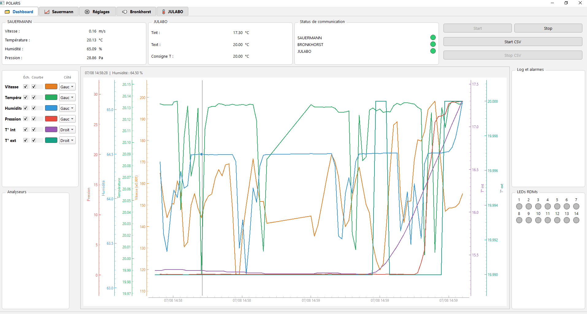
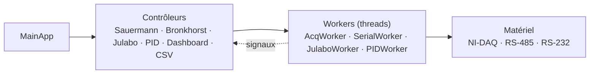
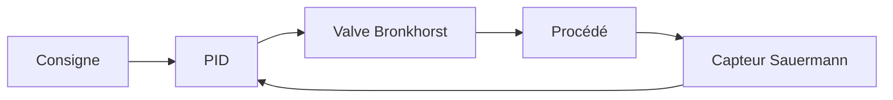
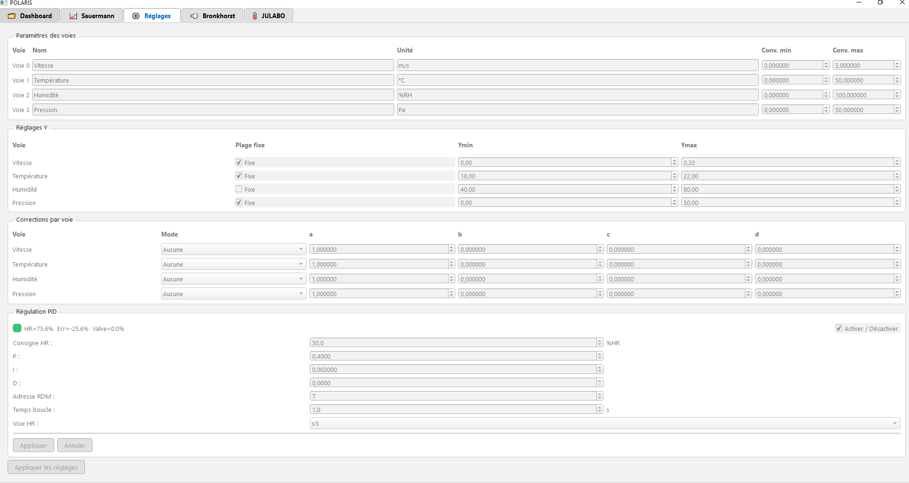
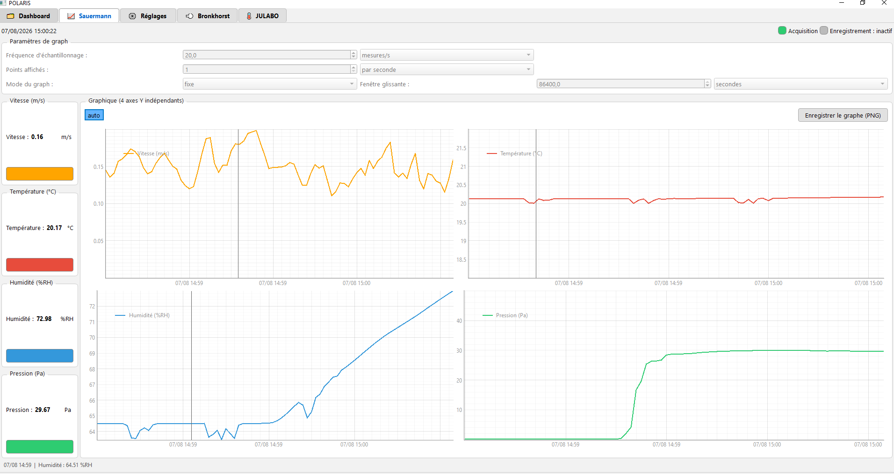

# POLARIS 🌌
**Pollutant & Operational Long-term Atmospheric Regulation Instrumental System**


# Présentation

POLARIS est une application de supervision et de régulation d'instruments de laboratoire, développée en **Python / PySide6** lors d'un stage à l'**INERIS** (mars – septembre 2026).

POLARIS pilote en même temps des régulateurs de débit **Bronkhorst**, un bain thermostaté **Julabo**, un capteur transmetteur **Sauermann** (carte NI-DAQ) et un analyseur de poluant **Airmovoc** . Elle régule l'humidité par **PID**, trace les mesures en temps réel et les enregistre en **CSV**.



## Bibliothèques

| Bibliothèque | Rôle |
|---|---|
| PySide6 | Interface Qt, threads, signaux/slots |
| pyqtgraph | Graphiques temps réel |
| NumPy | Calculs sur les mesures |
| nidaqmx | Acquisition NI-DAQ |
| propar | Dialogue avec les appareils Bronkhorst |
| pyserial | Liaison série avec le Julabo |
| simple-pid | Régulation PID |

## Architecture

Un contrôleur par onglet, des **workers** dans des threads séparés pour le matériel. Les workers ne touchent jamais l'interface : tout remonte par **signaux Qt**.



## Interface Qt Designer et classes

L'interface est dessinée dans **Qt Designer** (`POLARIS.ui`), convertie en Python, puis utilisée par le code sans jamais être modifiée à la main :

```bash
pyside6-uic POLARIS.ui -o UI_POLARIS.py
```

La logique est dans `POLARIS.py` :

| Classe | Rôle |
|---|---|
| `MainApp` | Fenêtre principale, création et câblage des contrôleurs |
| `BronkhorstController`, `DeviceTile` | Onglet Bronkhorst, une tuile par appareil |
| `JulaboController`, `JulaboWorker` | Onglet et acquisition Julabo |
| `SauermannController`, `AcqWorker` | Acquisition et traitement des 4 voies analogiques |
| `PIDController`, `PIDWorker` | Régulation PID |
| `DashboardController` | Vue de synthèse |
| `CsvManager` | Enregistrement des données |


## Protocoles de communication

| Instrument | Liaison | Protocole |
|---|---|---|
| Bronkhorst | **RS-485** (bus multipoint, adresses 1 à 127) | **Propar** : lecture et écriture de paramètres numérotés |
| Julabo | **RS-232** (4800 bauds, 7E1) | Commandes **ASCII** (`in_pv_00`, `out_sp_00 25.00`) |
| Sauermann | Analogique 0–10 V | Acquisition par carte NI-DAQ |

- **RS-232** relie deux appareils ; **RS-485** permet plusieurs appareils sur le même bus.
- **Propar** est le protocole maître/esclave de Bronkhorst. Un seul `SerialWorker` accède au port : les consignes passent par une file d'attente.
- **Modbus** n'est pas utilisé dans POLARIS. C'est l'équivalent normalisé de Propar sur RS-485 (adresse, fonction, registres, CRC).

## Régulation PID

Le PID règle l'**humidité** en agissant sur la **valve** d'un régulateur Bronkhorst. À chaque période, il lit la mesure Sauermann, calcule une sortie limitée à 0–100 % et l'envoie à la valve.



- Bibliothèque `simple-pid`, dans son propre thread.
- **Démarrage sans à-coup** (*bumpless transfer*) : le PID repart de la position actuelle de la valve.
- Gains Kp, Ki, Kd, consigne et période réglables dans l'onglet PID.



## Enregistrement CSV

Un fichier `acq_polaris_AAAA-MM-JJ_HH-MM.csv` regroupe tous les instruments : **une ligne par bloc d'acquisition**, avec la moyenne des mesures de chaque instrument sur le bloc. Format compatible Excel (séparateur `;`, virgule décimale), écriture ligne par ligne.


## Graphiques pyqtgraph

Courbes temps réel sur chaque onglet : axes de temps, double axe Y, curseur de lecture, échelles fixes ou automatiques, fenêtre glissante, et allègement de l'affichage sur les longues séries.



## Installation

```bash
pip install PySide6 pyqtgraph numpy nidaqmx pyserial bronkhorst-propar simple-pid
python POLARIS.py
```

## Auteur

**Zakaria Askander** — Master CCI, Université Claude Bernard Lyon 1.
